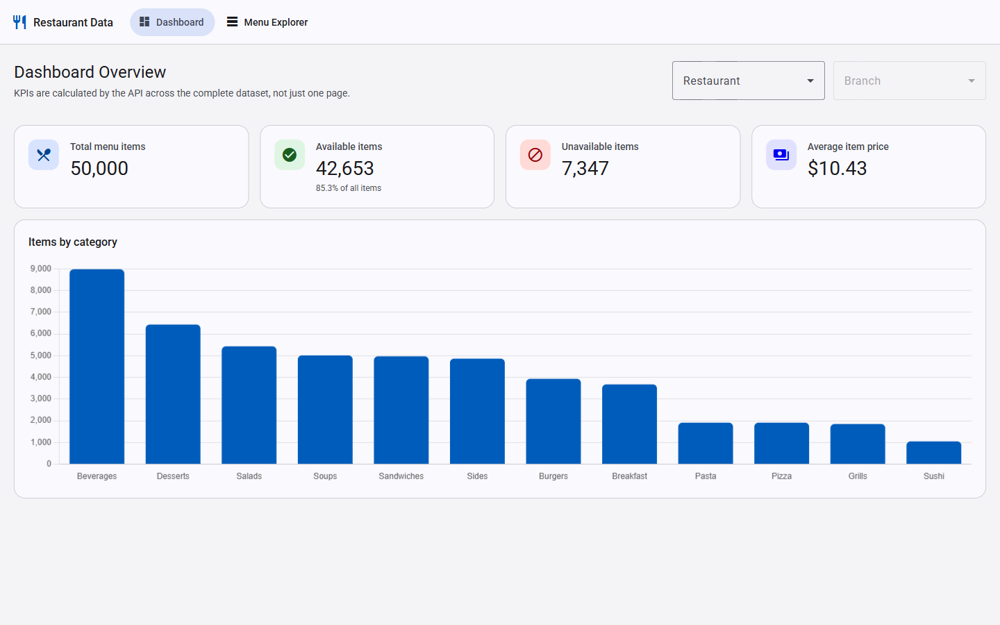
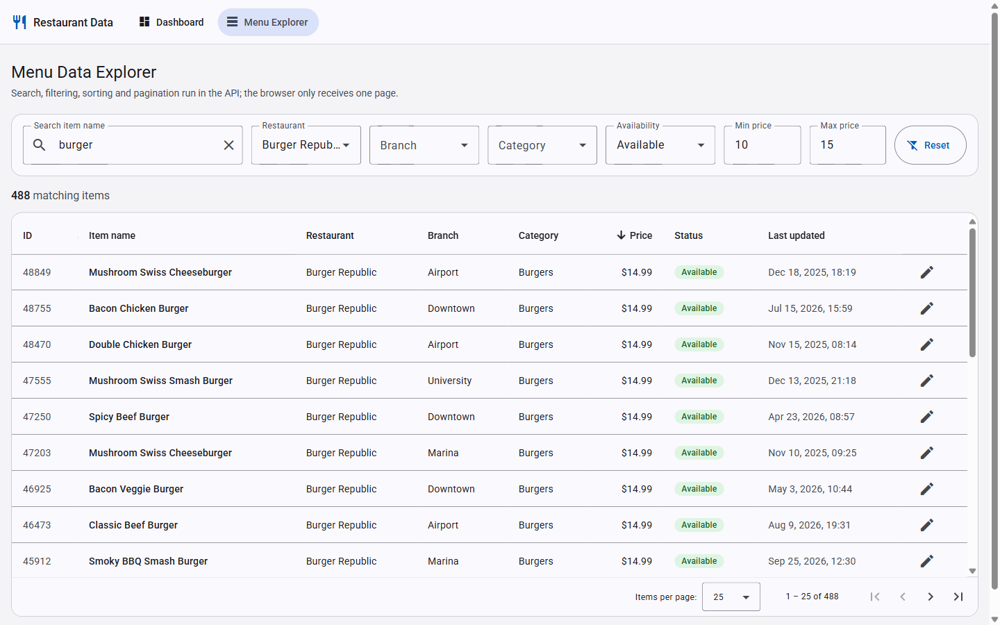
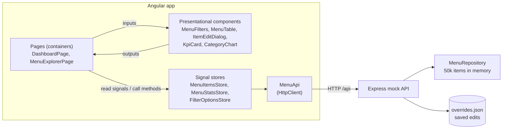

# Restaurant Data Management Dashboard

An Angular 21 dashboard for exploring and editing **50,000 menu items** across 8 restaurants, 28 branches and 12 categories.

Search, filtering, sorting, pagination and KPI aggregation all happen in a Node.js mock API. The browser only ever holds one page of 25–100 rows.

| Dashboard Overview                        | Menu Data Explorer                            |
| ----------------------------------------- | --------------------------------------------- |
|  |  |

## Quick start

Requirements: **Node.js 20.19+, 22.12+ or 24+** and npm.

```bash
npm install
npm start
```

Open **http://localhost:4200**.

`npm start` runs two processes together:

- the mock API on port 3000;
- the Angular dev server on port 4200, which proxies `/api` to port 3000.

On the first start, the API generates the 50,000-item dataset into `server/data/`. This takes about a second.

| Command                                            | What it does                                                                                                                             |
| -------------------------------------------------- | ---------------------------------------------------------------------------------------------------------------------------------------- |
| `npm start`                                        | Runs the API and the app.                                                                                                                |
| `npm run start:slow`                               | Same, but the API adds a random 0–1.5 s delay and fails 15% of requests. Use it to see loading, error/retry and stale-response handling. |
| `npm test`                                         | Runs all tests: API (`node:test`) and Angular (Vitest).                                                                                  |
| `npm run test:api` / `npm run test:web`            | Runs one of the two suites.                                                                                                              |
| `npm run generate:data -- --count 100000 --seed 7` | Regenerates the dataset with another size or seed. This also resets edits.                                                               |
| `npm run data:reset`                               | Undoes all item edits.                                                                                                                   |
| `npm run build`                                    | Production build of the Angular app.                                                                                                     |
| `npm run typecheck`                                | Type-checks the API and the app.                                                                                                         |

## Technology choices

| Area            | Choice                                                        | Why                                                                                                                                                                                                    |
| --------------- | ------------------------------------------------------------- | ------------------------------------------------------------------------------------------------------------------------------------------------------------------------------------------------------ |
| Framework       | Angular 21: standalone components, zoneless, new control flow | The current stable major that runs on every Node LTS. Angular 22 needs Node 24.15+, which would make the project harder for reviewers to run.                                                          |
| State           | Angular Signals + RxJS                                        | Signals hold state and drive OnPush rendering. RxJS is used where it adds value: debouncing input and cancelling outdated requests with `switchMap`. NgRx would mostly add boilerplate for this scope. |
| UI              | Angular Material                                              | Accessible table, sort, paginator, form fields and dialog.                                                                                                                                             |
| Chart           | Chart.js, used directly                                       | One bar chart does not need a wrapper library. Only the bar chart parts are registered, which keeps the bundle small.                                                                                  |
| Mock API        | Express 5 + TypeScript, run with `tsx`                        | Small, explicit query handling. All filtering, sorting and paging is server-side.                                                                                                                      |
| Shared contract | `shared/models.ts`                                            | The client and server import the same types and validation limits, so they cannot drift apart.                                                                                                         |
| Tests           | Vitest (via `ng test`), `node:test`                           | Vitest is the Angular 21 default. `node:test` needs no extra dependencies for the API.                                                                                                                 |

## Architecture



```
shared/models.ts              API contract used by both sides
server/
  generator.ts                Seeded, reproducible dataset generator
  query.ts                    Pure functions: parse/validate queries, filter, sort, paginate, stats
  menu-repository.ts          In-memory "database" with cached sort orders
  persistence.ts              Dataset file + overrides file (saved edits)
  app.ts / main.ts            Express routes, simulated latency and errors, startup
  api.test.ts                 API tests
src/app/
  core/menu-api.ts            Data-access layer: the only code that knows URLs and HTTP
  state/                      Stores (UI state + server state) and the shared loading helper
  features/dashboard/         Dashboard page, KPI card, category chart
  features/menu-explorer/     Explorer page, filters, table, edit dialog
  shared/                     Error banner, form validators
```

The layers only talk one way: **components → stores → `MenuApi` → HTTP**. Components never call `HttpClient` and never hold shared state.

- Pages inject stores.
- Child components are presentational: they only have inputs and outputs, which makes them simple to reuse and test.

## State management

Each store keeps **UI state** (what the user asked for) separate from **server state** (what the API returned):

| Store                | UI state                                | Server state                                                |
| -------------------- | --------------------------------------- | ----------------------------------------------------------- |
| `MenuItemsStore`     | `query`: filters, sort, page, page size | items on the current page, total matches, `status`, `error` |
| `MenuStatsStore`     | dashboard restaurant / branch filter    | KPIs and counts per category, `status`, `error`             |
| `FilterOptionsStore` | –                                       | restaurants, branches, categories for the dropdowns         |

All three stores use one helper, `connectRemoteState` (in `src/app/state/remote-state.ts`):

```
request signal ──toObservable──► switchMap(fetch) ──► RemoteState { data, status, error }
reload$ ─────────────────────────┘
```

- **Explicit states:** `status` is always one of `idle`, `loading`, `success` or `error`, and the error message comes from the API's error body.
- **Previous data stays visible** while the next request loads. The table dims instead of going blank.
- **No stale responses:** `switchMap` unsubscribes from the previous request, which aborts the HTTP call. A slow, older response can therefore never overwrite newer results.
- **No unnecessary requests:**
  - The query signal uses a shallow-equality check, so setting identical filters sends nothing.
  - Several changes made in the same tick are combined into one request. For example, changing the sort resets the page, and that still sends only one request.
- **Predictable transitions:** state changes only through store methods: `setFilters`, `setSort`, `setPage`, `reload` and `updateItem`.
  - New filters or a new sort always go back to page 1.
  - On the dashboard, choosing a restaurant clears the branch.

### Editing an item (the required demonstration)

1. **Validation in the dialog.** The edit dialog's reactive form checks the price: it is required, must be between 0.01 and 10,000, and can have at most 2 decimals. While the form is invalid, Save stays disabled.
2. **Save through the store.** The dialog calls `MenuItemsStore.updateItem()`, which calls `MenuApi.updateItem()`, which sends `PATCH /api/items/:id`.
3. **Validation and saving on the server.** The API validates the change again. It saves the change to `server/data/overrides.json`, and only then replies.
4. **State updates on success.** The store:
   - replaces the row in place, so the table changes at once;
   - fetches the current page again, because the edited item may no longer match the filters or may sort to a new position;
   - asks `MenuStatsStore` to reload, so the KPIs and the chart stay consistent.
5. **Persistence.** Edits live on the server, both in memory and in `overrides.json`. They survive a browser refresh and even an API restart.

The update is _pessimistic_: the UI changes after the server confirms the save. This keeps the state correct without any rollback logic, and the dialog shows "Saving…" while it waits.

## Large-data strategy

- **The server owns the data.**
  - The 50,000 items stay in the API's memory.
  - Angular receives at most 100 rows plus a `total` count per request.
  - Loading all items into the browser is never needed.
- **One filtering pass per request.** All active filters are combined into a single predicate.
- **Cached sort orders.** A sorted copy of the data is built once per sort field and then reused. Requests filter the already-sorted list instead of sorting on every call. An edit only invalidates the orders it affects (price or last updated).
- **Aggregates come from the server.** `GET /api/stats` computes all KPIs and the category counts in a single pass. Filtering the dashboard downloads about 1 KB of numbers, not the items.

Measured locally, through the full HTTP round trip with 50,000 items:

| Request                                 | Time   |
| --------------------------------------- | ------ |
| Sort by name, first time (builds cache) | ~29 ms |
| Sort by name, any later page            | ~2 ms  |
| Search + sort by last updated           | ~36 ms |
| Server start (load 50k items from disk) | ~65 ms |

## Performance optimizations (client)

- **OnPush everywhere + signals + zoneless change detection** (the Angular 21 default). Only components whose signals changed are checked.
- **Small DOM.** Only the current page is rendered, and rows are tracked by `id`, so unchanged rows are reused.
- **Fewer requests.** Filter input is debounced (300 ms), then `distinctUntilChanged`, then checked by signal equality. In the browser, typing "burger" letter by letter sends **one** request.
- **Cancelled requests.** `switchMap` aborts outdated HTTP calls.
- **Lazy-loaded routes.** Each page's code loads on first visit.
- **Small bundle.** The production initial bundle is 476 kB raw, about 114 kB transferred.
- **Chart updates in place.** The chart updates its data instead of being rebuilt.

## API

| Method & path          | Description                                                                                                                                                                                                                                              |
| ---------------------- | -------------------------------------------------------------------------------------------------------------------------------------------------------------------------------------------------------------------------------------------------------- |
| `GET /api/items`       | One page of items. Accepts `page`, `pageSize` (max 100), `search`, `restaurantId`, `branchId`, `category`, `available`, `minPrice`, `maxPrice`, `sortBy` (`name`, `price` or `lastUpdated`) and `sortOrder`. Returns `{ items, total, page, pageSize }`. |
| `PATCH /api/items/:id` | Body `{ price?, available? }`. Validates the input, saves it and returns the updated item. Returns `400` with `details` for invalid input and `404` for an unknown id.                                                                                   |
| `GET /api/stats`       | Total, available, unavailable, average price and counts per category. Accepts the same filters as `/api/items`.                                                                                                                                          |
| `GET /api/filters`     | Restaurants with their branches, plus categories, for the dropdowns.                                                                                                                                                                                     |

Invalid query parameters return `400` with readable messages. For example:

```
GET /api/items?sortBy=color&minPrice=20&maxPrice=5
→ 400 { "message": "Invalid query parameters", "details": ["\"minPrice\" cannot be greater than \"maxPrice\"", ...] }
```

## Tests

```bash
npm test
```

This runs 24 tests: 14 for the API and 10 for Angular.

**Angular** (`src/**/*.spec.ts`, Vitest with `HttpTestingController`):

- `menu-items.store.spec.ts`:
  - **Combined filtering and pagination:** all filters, the sort and the page go out in one request. A filter change goes back to page 1. Identical filters send no request.
  - **Stale responses:** the older request is cancelled, so only the newest results are shown.
  - **API errors:** the store moves to the error state and keeps the previous rows. Retry recovers.
  - **State after editing:** the row updates immediately, then the page and the KPIs are fetched again. A rejected edit leaves the state unchanged.
- `menu-stats.store.spec.ts`: dashboard filtering fetches only aggregates, and changing the restaurant clears the branch.
- `menu-filters.spec.ts`: fast typing is debounced into a single change, and an invalid price range is never emitted.
- `validators.spec.ts`: the 2-decimal price rule.

**API** (`server/api.test.ts`, `node:test`):

- Search, all filters, sorting and pagination combined.
- Sorting is correct again after an edit.
- Invalid query parameters are rejected.
- The generator is reproducible.
- Stats are correct for the full set and for a filtered subset.
- PATCH validation rejects bad input.
- An HTTP-level test checks that a PATCH updates the stats and is written to the overrides file.

I checked that the tests test real logic, not just that code runs. When `switchMap` is swapped for `mergeMap`, the stale-response test fails.

## Known limitations

- **Single-select filters:** one restaurant, branch or category at a time.
- **Filters are not in the URL.** Filters, sort and page stay in memory, so they survive moving between pages but reset on a browser refresh. Edits themselves do persist.
- **Simple mock API.** It has no authentication and no protection against two people editing the same item at once (the last write wins).
- **Simple search.** It is a case-insensitive substring match on the item name, with no fuzzy matching or ranking.
- **Stats scan all items.** `/api/stats` scans the whole dataset on each request, which takes a few milliseconds for 50,000 items. Much larger data would need pre-computed counters or database aggregation.
- **No end-to-end tests.** The full flow was checked by hand in the browser. The automated tests are unit and API integration tests.

## Time spent

**TODO: fill in before submitting.**

## What I would improve with more time

- **Filters in the URL:** sync filters, sort and page to the URL query parameters, so views can be shared and survive a refresh.
- **Optimistic editing:** update the UI before the server confirms, roll back on failure, and add version checks to prevent conflicting edits.
- **More filtering options:** multi-select filters, and quick availability toggles directly in the table rows.
- **A real backend:** NestJS with Swagger/OpenAPI and MongoDB indexes instead of the in-memory mock.
- **End-to-end tests:** Playwright tests for the full edit → KPIs → refresh flow.
- **Faster stats:** update the stats counters on each edit instead of scanning everything.
